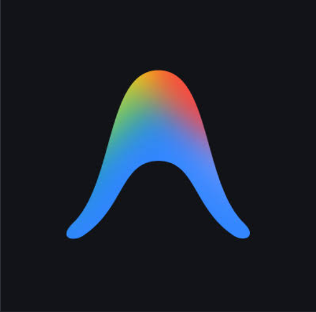
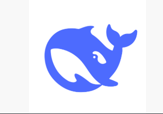
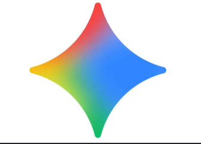

<h1 align="center">Hi, I'm Ashitesh Singh 👋</h1>

  <b>Quantum Computing · Machine Learning · Cybersecurity</b>

  

  
  
  

---

## 👋 About Me

🧑‍🔬 **Role**  
**Quantum Computing Researcher**

🤖 **Right now**  
**ML Engineer and Researcher Fellow at Anthology Research by Polymath AI Labs**

🎓 **Research Focus**  
Combining **Machine Learning and Quantum Computing (QML)** to engineer high-performance distributed simulators and optimize QML trainability.

🏆 **Open Source**  
Contributor to **TensorFlow** and **JAX**, and developer of the **37-qubit distributed TPU simulator**.

🏫 **Education**  
Grade 12 at **Little Flower School**, managing tech alongside academics.

---

## 🛡️ Cybersecurity Work

During **independent security research and Android reverse engineering**, I discovered a vulnerability chain in a school ERP platform involving **insecure credential storage, excessive cloud permissions, and weaknesses in access controls**.

If exploited, these vulnerabilities could have led to a data breach affecting an **estimated 5 million+ students, parents, and teachers across India**. This represents the estimated potential platform-wide impact.

I coordinated **responsible disclosure through CERT-In**, documenting the findings to support verification and remediation. My published write-up covers the investigation, disclosure timeline, vendor remediation, and **CERT-In acknowledgment**.

📖 **[Read the responsible disclosure write-up →](https://ashitesh.me/responsible-disclosure-how-a-single-mobile-flaw-exposed-million-student-parent-teacher-records-across-india)**

---

## 🛠️ Tech Stack & Language Toolbox

  

  

---

## 🤖 Tools & LLMs I Use

  <b>AI tools and assistants in my workflow</b>

<table align="center">
  <tr>
    <td align="center" width="130">
      
        
      <b>Codex</b>
    </td>
    <td align="center" width="130">
      
        
      <b>Kiro</b>
    </td>
    <td align="center" width="130">
      
        
      <b>Antigravity</b>
    </td>
    <td align="center" width="130">
      
        
      <b>DeepSeek</b>
    </td>
    <td align="center" width="130">
      
        
      <b>Gemini</b>
    </td>
  </tr>
</table>

---

## 🏆 Featured Quantum & AI Projects

### 🚀 TPU-Accelerated Quantum Simulation in JAX

**[Tpu-Accelerated-Quantum-JAX](https://github.com/AshiteshSingh/Tpu-Accelerated-Quantum-JAX)**

High-performance, differentiable quantum state-vector & tensor network simulator in **100% pure JAX**, with no classical framework overhead.

Accelerated on **NVIDIA GPUs** and **Google Cloud TPU v6e-64/v5e VM clusters**, scaling up to **37 qubits**. Supported by **Google's TPU Research Cloud (TRC) program**.

📄 **Research publications:**  
[Zenodo · 10.5281/zenodo.20701872](https://doi.org/10.5281/zenodo.20701872)  
[Zenodo · 10.5281/zenodo.20704990](https://doi.org/10.5281/zenodo.20704990)

### 🌐 Perplexity GUI

**[Perplexity-gui-copy](https://github.com/AshiteshSingh/Perplexity-gui-copy)**  
Next.js + TypeScript clone of Perplexity AI.

### 🔍 Neural Search Engine

**[Neural-Search-Engine1](https://github.com/AshiteshSingh/Neural-Search-Engine1)**  
AI-powered search tool.

### 🏡 House Price Prediction

**[House-price-prediction](https://github.com/AshiteshSingh/House-price-prediction)**  
Advanced hybrid ML pipeline with Transformer DNN.

### 📖 Little Flower School Magazine

**[LFS Magazine](https://weblfsmagazine.online/)**  
Built the official digital magazine for Little Flower School.

---

## 📊 GitHub Activity

  

  

  

---

## 📫 Connect with Me

  
  
  

  

